# ElektroRechner

Elektro-, Gebäudeautomations- und Industrie-Rechner für **Windows und Android** – ein C++20-Rechenkern mit einer
Qt-6-Quick-Oberfläche. Inspiriert von „Elektro-Berechnungen“, aber mit Schwerpunkt auf Planung in
**Gebäudeautomation (GA/MSR)** und **Industrie**, umschaltbar **Deutsch/Englisch** und **DE (DIN VDE) / CH (NIN)**.

**Neu in 1.8 – Kapitel „Ressourcen“** im Bereich Elektrotechnik (alle 27 Punkte des Reiters „Ressourcen“ der App
„Elektroberechnungen“): Sicherungs-Kennzeichnung und UL/CSA-Klassen, E-Reihen, **Auslösekennlinien** (Diagramm mit
logarithmischen Achsen), Reaktanzbeläge, spezifische Widerstände, Spannungsfall je A·m, Leiterdaten, **Netzsysteme TN/TT/IT
als Schaltbild**, IP/IK/NEMA, ATEX, Schutzklassen, CCTV-Auflösungen, Thermoelement-Farben, ANSI-Gerätenummern,
Geräteabkürzungen, **Schaltzeichen nach IEC 60617** (5 Seiten), Netzspannung und Stecker weltweit, Steckertypen A–O,
IEC 60320, CEE (IEC 60309), NEMA-Stecker, E-Auto-Ladestecker, Aderfarben international, SI-Vorsätze und Einheiten,
Rohrabmessungen und Kabelverschraubungen.

| Ressourcen | Auslösekennlinien | Schaltzeichen |
|---|---|---|
| 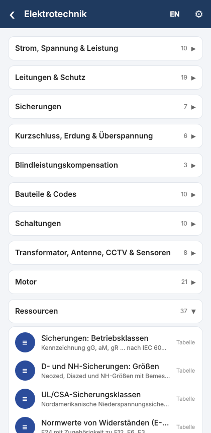 | 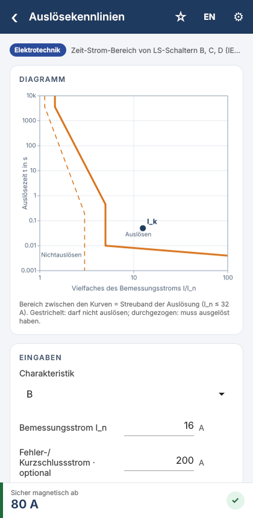 | 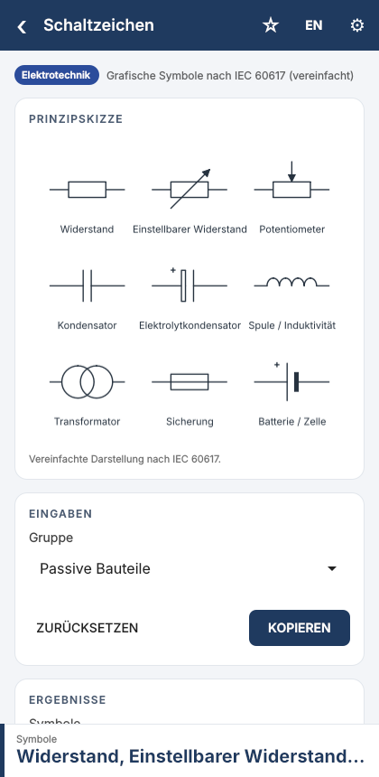 |

**Neu in 1.7 – Bereich „Elektrotechnik“** (nach der Menüliste der App „Elektroberechnungen“, Screenshots per
doc2md/OCR erfasst): eine Kachel mit 10 aufklappbaren Gruppen und über 100 Einträgen – Strom/Spannung/Leistung,
Leitungen & Schutz, Sicherungen, Kurzschluss/Erdung/Überspannung, Kompensation, Bauteile & Codes, Schaltungen,
Transformator/Antenne/CCTV/Sensoren, Motor und Umrechnung. Vorhandene Rechner erscheinen dort mit, neu sind u. a.:
- **Leitungen:** mineralisolierte Kabel, Kupfer-Sammelschienen, Kabel-R/X/Z, Kabeltemperatur, Verlustleistung,
  Neutralleiterstrom mit 3. Oberschwingung, Spannungsfall und Querschnitt bei verteilten Lasten, k²S²-Tabelle.
- **Schutz:** minimaler Kurzschlussstrom, Erdung/RCD (TT/TN), Überspannungs-Risikobewertung (CRL nach 443),
  Sicherungs-Tabellen (Betriebsklassen, D/NH, Zylinder, Feinsicherungen, Kfz).
- **Bauteile:** Farbringe aus Wert (mit Zeichnung), SMD-Code inkl. EIA-96, Kondensator- und Induktivitätscode,
  Stromteiler, Z-Diode, Vorwiderstand, Trafowicklung, Antennenlänge, CCTV-Speicher, Thermoelemente (NIST ITS-90), Cu-Fühler.
- **Motor:** Leistung/Spannung/cos φ, NEC-Volllaststrom, **Schaltschemata mit 6, 9 und 12 Klemmen** (Klemmbrett und
  Wicklungsbild), Drehrichtung, Klemmenkennzeichnung.
- **Umrechnung:** Dreieck-Stern (mit Zeichnung), AWG-/SWG-Tabellen, mm² ↔ AWG/kcmil, Querschnitt, Länge, Spannung (dB), Phasenwinkel.

| Elektrotechnik | Klemmbrett 6 Klemmen | Farbringe |
|---|---|---|
| 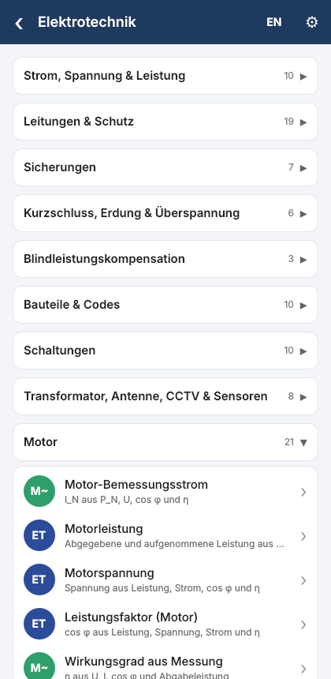 | 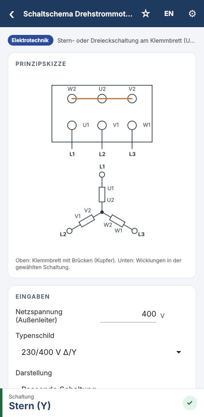 | 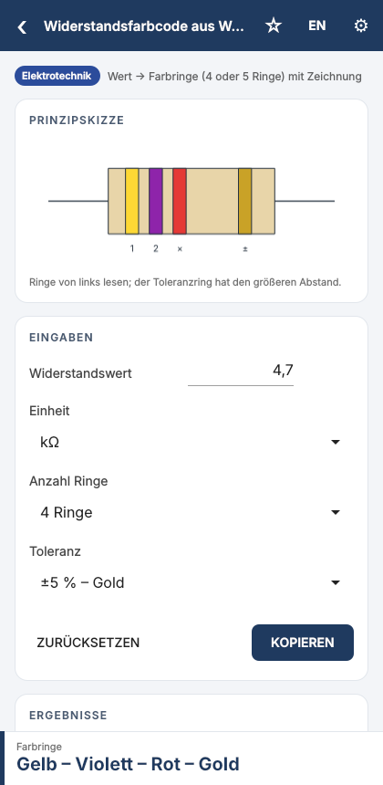 |

**Neu in 1.6:**
- **Hydraulische Grundschaltungen (Regelgruppen)** als Anleitung in *Gebäudetechnik & Energie*: acht Schaltungen
  (Drossel, Drossel mit PICV, Einspritz mit Durchgangsventil / PICV / Dreiwegventil, Beimisch, Beimisch mit fester
  Vormischung, Umlenk) mit **Prinzipskizze**, Funktionsweise, Eigenschaften, Einsatzbereich und Ventilauslegung.
  **Auswahlhilfe:** Verteiler, Einfriergefahr, Entfeuchtung, Rücklauf- und Vorlauftemperatur angeben → empfohlene
  Schaltung mit Begründung und Alternative. Dazu die Tabelle **Auswahl hydraulischer Grundschaltungen**.
  Quellen: Siemens „Einführung in die HLK- und Gebäudetechnik“ (08/2022) Kap. 5.4–5.5, Belimo-Auswahltabelle (03/2023);
  die Skizzen sind eigene Zeichnungen.
- **Bereiche ein- und ausblenden:** Auf der Startseite „Anpassen“ (oder in den Einstellungen) – ausgeblendete Bereiche
  verschwinden von der Startseite, die Suche findet weiterhin alle Rechner. Die Auswahl bleibt gespeichert.

| Beimischschaltung | Bereiche anpassen |
|---|---|
| 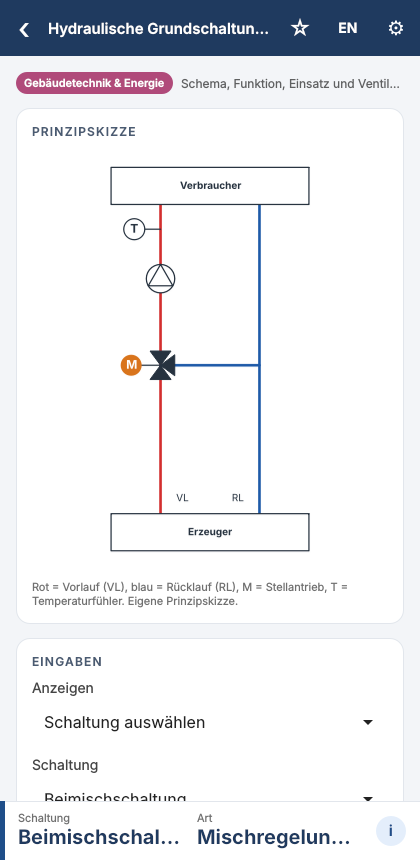 | 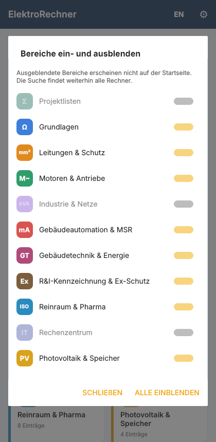 |

**1.5.1:** Kategorie-Kacheln auf der Startseite lassen sich wieder antippen (Fehler in 1.5.0).

**Neu in 1.5 – aktualisiert auf Basis der Fachbücher** (Siemens-Grundlagenbücher, Haag, KNX, AMEV, TROX, BAuA u. a.;
Verzeichnis und Markdown-Fassungen liegen im Ordner *Fachbücher*). Jeder neue Wert nennt Buch, Ausgabe und Seite:
- **Neue Kategorie Gebäudetechnik & Energie:** GA-Effizienzklasse nach EN ISO 52120 (BAC-Faktoren je Gebäudetyp,
  Einsparung in kWh und €/CHF), **Heizkennlinie** mit Steilheit, Parallelverschiebung und Diagramm, **Wärmepumpe**
  (Carnot-COP, Mindest-COP EN 14511, JAZ), **RLT-Gerät** (Geschwindigkeitsklasse EN 13053, SFP-Klasse, Kanaldurchmesser),
  **Nachhallzeit** nach Sabine mit Soll-Wert DIN 18041 und nötiger Absorberfläche, Schallpegel addieren,
  **Fluchtweg nach ASR A2.3** (aktuelle Fassung 2022 – das Buch enthält noch 2007), **Aufzugsschacht-Rauchabzug** (MBO/VKF).
- **Reglereinstellung** nach Ziegler/Nichols und Chien/Hrones/Reswick mit Schwierigkeitsgrad S = Tu/Tg,
  **KNX-Topologie** (Linien, Bereiche, Segmente, Längen, Netzteillast), **AMEV-Datenpunktadresse** (GA 2005) mit 5 Codetabellen.
- **Pumpe/Ventilator am FU:** Proportionalitätsgesetze mit Diagramm und Energieeinsparung.
- Bestehende Rechner gegen die Bücher geprüft und ergänzt: Ventil (kleinste regelbare Leistung, 1/3-2/3-Ventile),
  Transformator (I_kD, u_k-Richtwerte), Feldbusse (MS/TP, KNX), h,x-Höhentabelle, 5 Sicherheitsregeln & Schutzabstände.

| Heizkennlinie | Reglereinstellung | AMEV-Adresse (dunkel) |
|---|---|---|
| 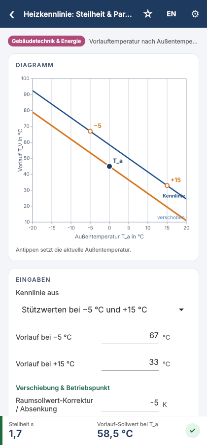 | 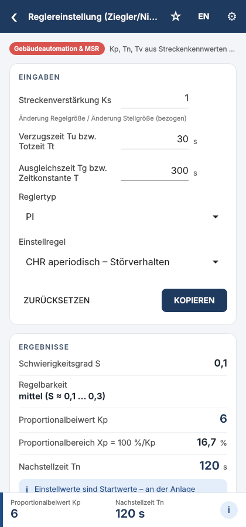 | 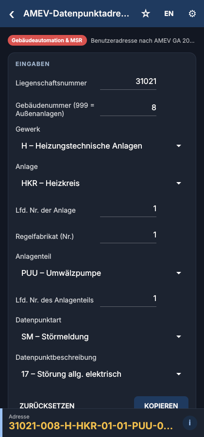 |

| Gebäudetechnik & Energie | Nachhallzeit |
|---|---|
| 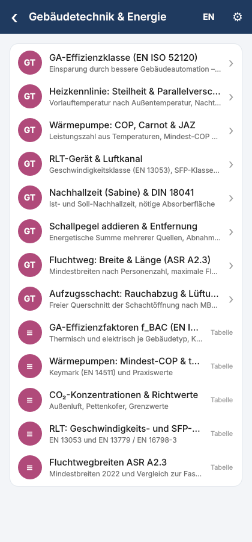 | 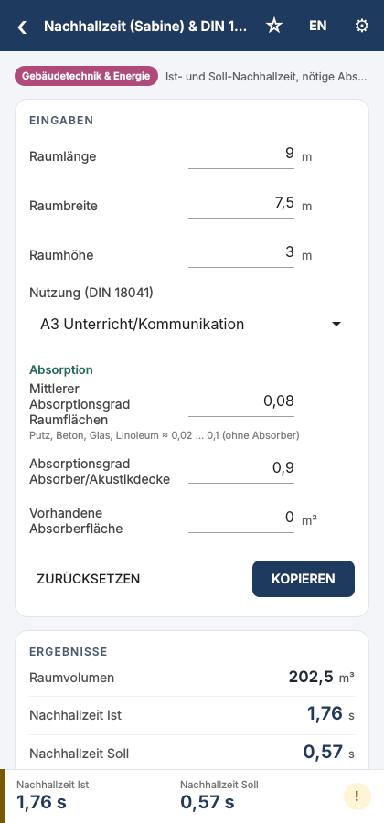 |

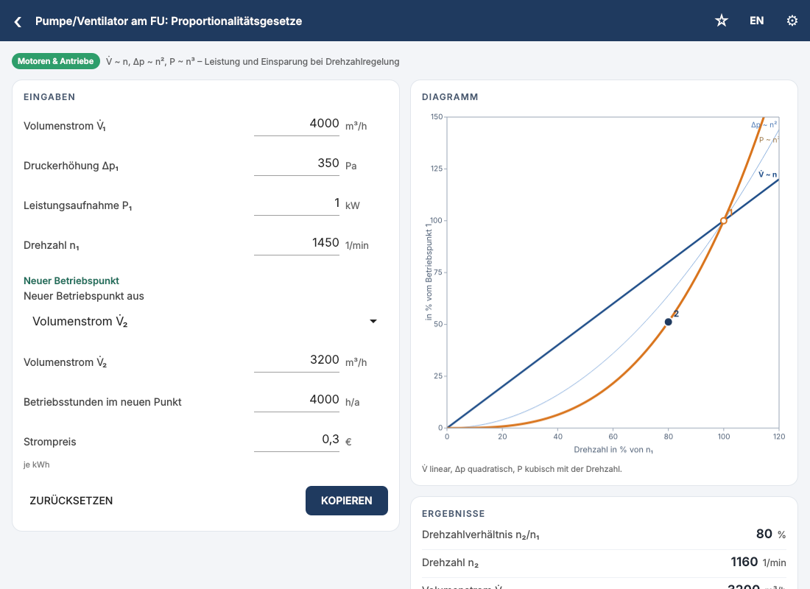

**Neu in 1.4:**
- **Währung € und CHF** – in den Einstellungen wählbar mit Wechselkurs; jedes Kostenergebnis zeigt zusätzlich den Betrag
  in der anderen Währung, dazu ein Umrechner € ↔ CHF.
- **Explosionsschutz** – Zone → Kategorie/EPL, Stoff → Temperaturklasse und Explosionsgruppe, Staub → zulässige
  Oberflächentemperatur, Geräteprüfung und Kennzeichnungsbeispiel; Tabellen T1–T6, Gruppen, Zonen, Zündschutzarten, Stoffe.
- **R&I-Kennbuchstaben-Finder** – Name eingeben („Temperatur Zuluft“, „Gas Methan“, „Leckage“, „Druckwächter min“) →
  ISA-5.1 (z. B. TT-101), EN 62424/DIN 19227, VDI-3814-Kürzel mit Benutzeradresse, IEC 81346, Signal und PI-Symbol;
  Tabelle mit 78 Sensoren und Wächtern für HLKS, MSR und Prozess sowie die Buchstabentabellen.

| Kennbuchstaben-Finder | Explosionsschutz |
|---|---|
| 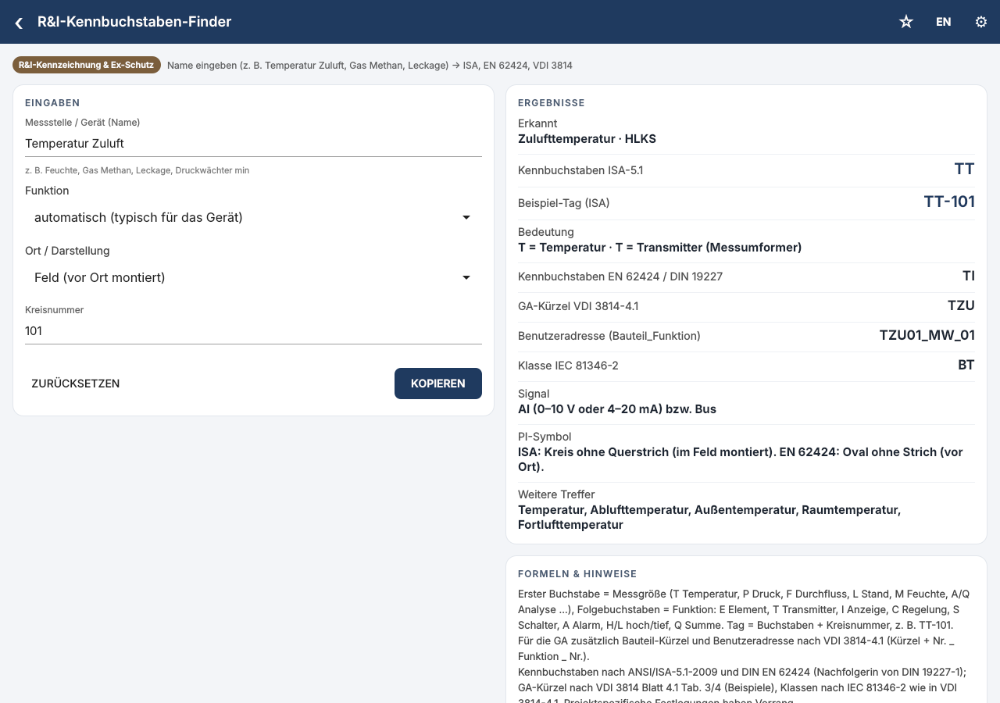 | 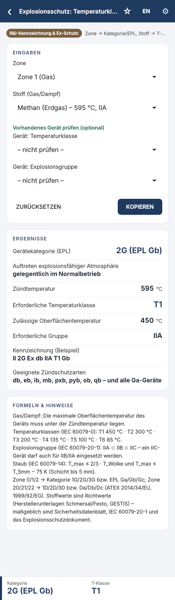 |

**Neu in 1.3: h,x-Diagramm (Mollier)** mit Taupunkt, Kühlgrenze und Zustandsänderungen (Heizen, Kühlen/Entfeuchten,
Dampf- und Verdunstungsbefeuchten, Mischen) – ins Diagramm tippen setzt Zustand 1. Dazu die **PUE-Bilanz** für
Rechenzentren aus den Verbrauchern (IT, USV, Verteilung, Kühlung mit EER und freier Kühlung) mit Jahresverbrauch,
Kosten, CO₂, Abwärme/ERF und EnEfG-Prüfung (geltende Fassung oder Kabinettsentwurf 2026).

| h,x-Diagramm (Desktop) | h,x-Diagramm (dunkel) | PUE-Bilanz |
|---|---|---|
| 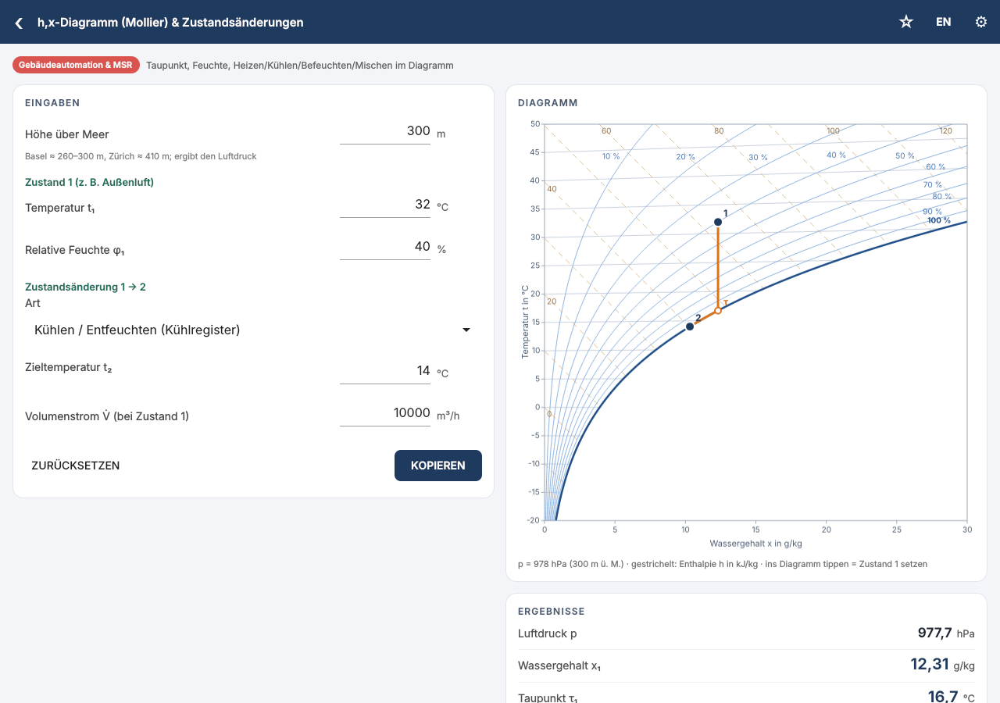 | 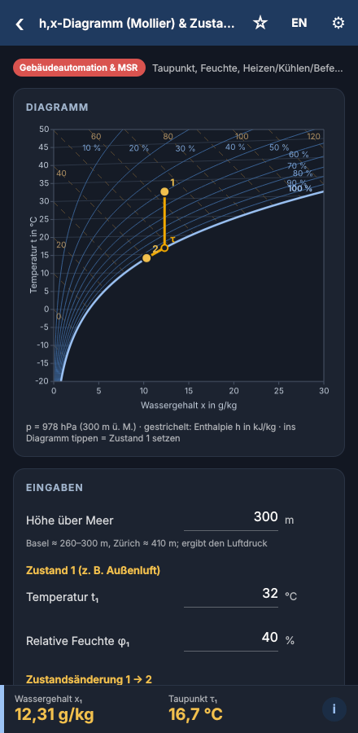 | 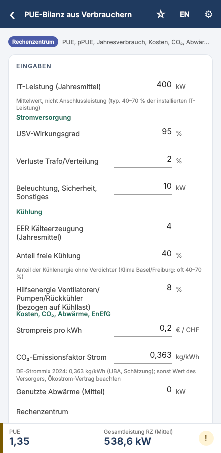 |

**Neu in 1.2: Projektlisten** – Verbraucherliste mit Kabelauslegung (Rechenweg der Excel-Vorlage
„Leistungsdaten_Kabelauslegung“) und GA-Datenpunktliste nach VDI 3814, mit Excel-Import/-Export:

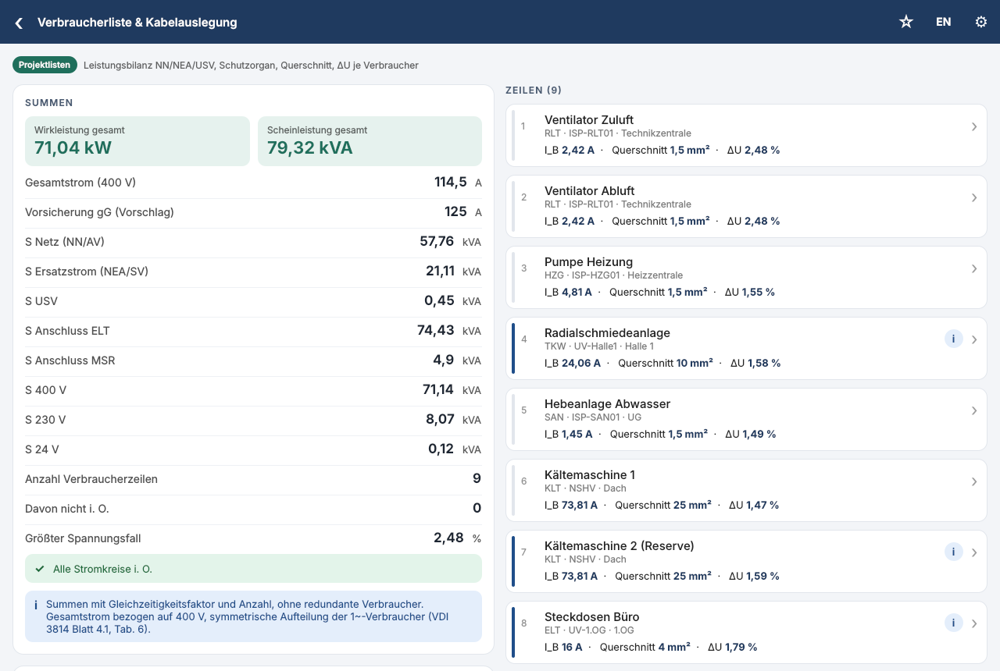

| GA-Datenpunktliste | Verbraucher bearbeiten |
|---|---|
| 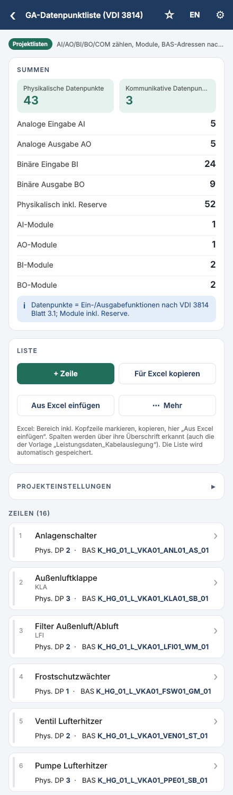 | 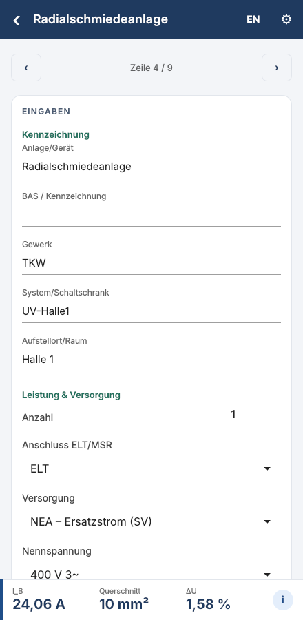 |

| Start | Spannungsfall | Dunkles Design | Tabelle |
|---|---|---|---|
| 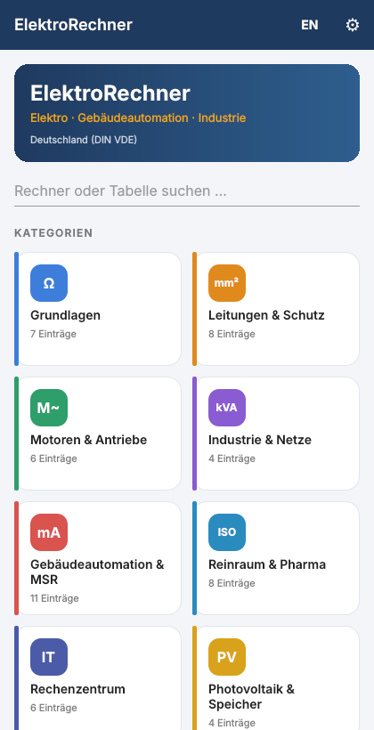 | 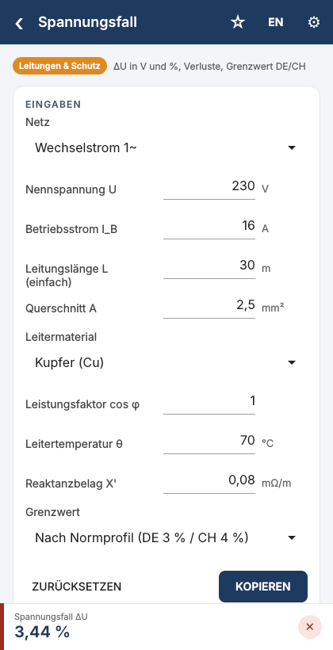 | 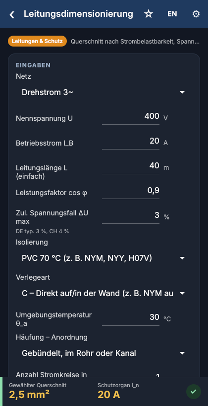 | 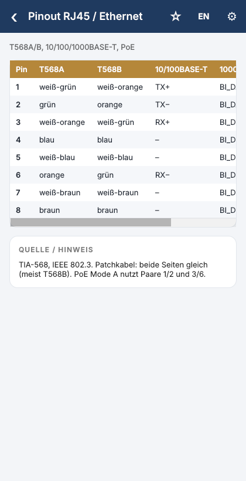 |

| Reinraum: FFU-Decke | Rechenzentrum: USV (dunkel) |
|---|---|
| 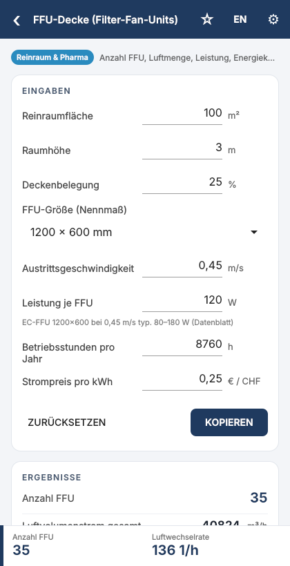 | 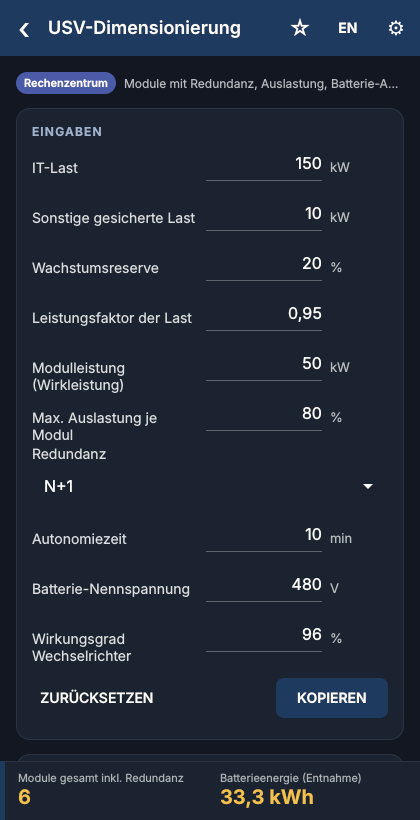 |

Auf breiten Fenstern (Windows, Tablet) stehen Eingaben und Ergebnisse nebeneinander:

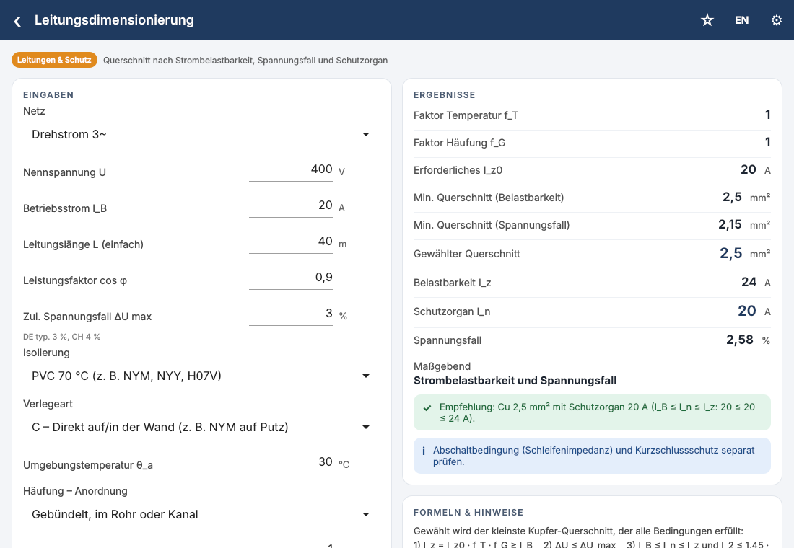

> **Ohne Gewähr.** Die Ergebnisse ersetzen keine normgerechte Planung und Prüfung durch eine Elektrofachkraft.
> Tabellen- und Grenzwerte vor Verwendung gegen die gültige Normausgabe prüfen.

---

## Funktionsumfang (Version 1.5)

**2 Projektlisten, 80 Rechner und 60 Tabellen** in 13 Kategorien. Alle Formeln, Eingaben und Quellen stehen in
[docs/BERECHNUNGEN.md](docs/BERECHNUNGEN.md) (englisch: [docs/CALCULATIONS.md](docs/CALCULATIONS.md)).

| Kategorie | Inhalt |
|---|---|
| **Projektlisten** *(neu)* | **Verbraucherliste & Kabelauslegung**: je Verbraucher S, I_B, Schutzorgan (MSS/SelMod einstellbar, LS B/C, gG mit NH-Größe), F_ges = f1·f2·f3·f4 (f1/f2 manuell oder aus Temperatur/Häufung), Querschnitt nach Belastbarkeit, I_Z, Prüfung I_B ≤ I_N ≤ I_Z (+ I_2 ≤ 1,45·I_Z), Spannungsfall mit R′(70 °C) und X′, optional automatische Querschnittserhöhung; Summen je NN/NEA/USV, ELT/MSR, 400/230/24 V, Vorsicherung. **GA-Datenpunktliste (VDI 3814)**: ~30 Bauteil-Vorlagen → AI/AO/BI/BO/COM, Module mit Reserve, Kostenschätzung, Benutzeradressen (BAS) nach VDI 3814-4.1, Detailliste je Datenpunkt |
| **Grundlagen** | Ohmsches Gesetz (beliebige 2 von U/I/R/P), Leistung P/Q/S/cos φ, Strom aus Leistung, Leiterwiderstand mit Temperatur, R/L- und C-Reihen-/Parallelschaltung, Energiekosten (€/CHF nach Normprofil) |
| **Leitungen & Schutz** | Leitungsdimensionierung (Belastbarkeit + Spannungsfall + Schutzorgan in einem Schritt), Spannungsfall mit Grenzwert DE/CH, Strombelastbarkeit I_z (Verlegearten A1–E, PVC/VPE, Temperatur, Häufung), Überlastschutz I_B ≤ I_n ≤ I_z, Abschaltbedingung/L_max (TN), max. Länge für 24-V-Kreise, Kurzschlussfestigkeit I²t, Rohrfüllung |
| **Motoren & Antriebe** | Bemessungsstrom, Drehmoment/Leistung/Drehzahl, Synchrondrehzahl & Schlupf, Wirkungsgrad, Stern-Dreieck-Anlauf, Steinmetzschaltung, **Pumpe/Ventilator am FU (Proportionalitätsgesetze, Einsparung)** |
| **Industrie & Netze** | Blindleistungskompensation, Transformator (Ströme, I_k, I_kD, u_k-Richtwerte), Kurzschlussstrom am Leitungsende (I_k3 max / I_k1 min nach IEC 60909, vereinfacht), Schaltschrank-Wärmebilanz (IEC/TR 60890) |
| **Gebäudeautomation & MSR** | Analogsignal-Skalierung 4–20 mA/0–10 V ↔ Messwert ↔ S7-Rohwert (27648) mit NAMUR NE 43, 4–20-mA-Bürde, Pt100/Pt1000/Ni1000/LG-Ni1000, Leitungsfehler 2-Leiter, NTC, 24-V-Trafo/-Netzteil, Ventil kv/kvs & Autorität (auch aus Leistung/ΔT wie in der Ventilliste VDI 3814-4.1, kleinste regelbare Leistung), Wärmeleistung ↔ Volumenstrom (Wasser/Luft), DALI-Leitung, **h,x-Diagramm (Mollier) mit Zustandsänderungen und Leistung/Kondensat**, feuchte Luft (Taupunkt, x, h) mit Diagramm, **Außenluftvolumenstrom nach EN 16798-1 / CO₂-Bilanz (UBA-Bewertung)**, **Reglereinstellung (Ziegler/Nichols, CHR)**, **KNX-Topologie**, **AMEV-Datenpunktadresse**; Tabellen VDI 3814-4.1 (Gewerke, Anlagen, Bauteile, Funktionskennungen), AMEV-Codes, Einstellregeln, h,x-Höhenkorrektur |
| **Gebäudetechnik & Energie** *(neu)* | GA-Effizienzklasse EN ISO 52120 (f_BAC thermisch/elektrisch, Einsparung), Heizkennlinie (Steilheit, Parallelverschiebung, Diagramm, Auslegung mit Heizkörperexponent), Wärmepumpe (Carnot-COP, Keymark-Mindest-COP, JAZ), RLT-Gerät & Luftkanal (V-Klasse, SFP-Klasse), Nachhallzeit Sabine/DIN 18041, Schallpegel, Fluchtweg ASR A2.3:2022, Aufzugsschacht-Rauchabzug DE/CH; Tabellen BAC-Faktoren, Wärmepumpen, CO₂-Richtwerte, RLT-Klassen, Fluchtwegbreiten |
| **R&I-Kennzeichnung & Ex-Schutz** *(neu)* | Kennbuchstaben-Finder (ISA-5.1, EN 62424, VDI 3814-4.1, IEC 81346) für 78 Sensoren/Wächter, Explosionsschutz (Temperaturklasse, Gruppe, Zone/Kategorie/EPL, Staub nach IEC 60079-14, Kennzeichnung, Geräteprüfung); Tabellen Kennbuchstaben, T-Klassen, Ex-Gruppen, Zonen, Zündschutzarten, Zündtemperaturen |
| **Reinraum & Pharma** | ISO 14644-1 Klasse ↔ Grenzwert (beide Richtungen), Messstellenanzahl & Probenvolumen, Luftwechsel & Erholzeit 100:1, FFU-Decke (Anzahl, Luftmenge, Wärmelast, Energiekosten), Überströmung/Druckkaskade; Tabellen ISO-Klassen, EU-GMP Annex 1 Partikel und Keime |
| **Rechenzentrum** | PUE/DCiE aus Leistung **oder Jahresverbrauch (Zähler)**, **PUE-Bilanz aus Verbrauchern** (pPUE Kühlung/Strom, Jahresverbrauch, Kosten, CO₂, Abwärme, ERF), EnEfG-Prüfung Bestand/Neubau (2023 oder Entwurf 2026), Rack-Kühlung & Kühlgeräte mit Redundanz (N+1/N+2/2N), USV-Module & Batterie-Autonomie, Verfügbarkeit/Ausfallzeit; Tabellen ASHRAE TC 9.9, EN 50600/Tier |
| **Photovoltaik & Speicher** *(neu)* | String-Auslegung mit Temperaturkorrektur (U_oc bei Kälte, U_mpp bei Hitze, MPP-Bereich, Strangsicherung), Ertrag & Amortisation (€/CHF), DC-Leitungsverluste, Speichergröße mit Faustformeln |
| **Elektronik** | Farbcode 4/5 Ringe, E-Reihen E6–E96, LED-Vorwiderstand, Spannungsteiler, RC-Glied, LC-Schwingkreis, Impedanz RLC, Akku-/USV-Laufzeit |
| **Umrechner** | **Währung € ↔ CHF**, Leistung (W, PS, hp, BTU/h, kcal/h, TR), Energie, Temperatur, Druck (bar, psi, mWS), Volumenstrom (m³/h, l/s, CFM), AWG ↔ mm² |
| **Tabellen & Pinouts** | IP-Schutzarten, Schutzklassen, Netzsysteme, Aderfarben, Spannungsfall-Grenzwerte DE/CH, Strombelastbarkeit (4 Tabellen), Temperatur- und Häufungsfaktoren, LS-Charakteristiken, D-Sicherungen, Kabeltypen, **Feldbusse** (BACnet MS/TP, Modbus, KNX, DALI, LON, PROFIBUS, CAN, IO-Link, Ethernet), Isolierstoffklassen, Betriebsarten, IE-Klassen, **5 Sicherheitsregeln & Schutzabstände**, Klemmbrett Y/Δ, Bauformen, Pinouts RJ45/PoE, RS-485, M12, KNX, RS-232, USB, HDMI, Farbcode, SI-Vorsätze |

Weitere Funktionen: Live-Berechnung bei jeder Eingabe, Ergebnisleiste mit Ampelstatus, Suche, Favoriten,
Ergebnis kopieren (für Berichte/E-Mails), dunkles Design, Dezimalkomma oder -punkt.

### Projektlisten und Excel

- **Aus Excel einfügen:** In Excel den Bereich **mit Kopfzeile** markieren → Strg+C → in der App *Aus Excel einfügen*
  (Liste ersetzen oder anhängen). Spalten werden über die Überschrift erkannt – auch die Überschriften der Vorlage
  „Leistungsdaten_Kabelauslegung“ (z. B. „Nennleistung ASV / kW“, „f2 Häufung“, „Länge Leitung / m“).
  Leere Vorlagenzeilen ohne Namen werden übersprungen; fehlende Spalten erhalten Standardwerte.
- **Für Excel kopieren:** Tabelle mit allen Eingaben, Ergebnissen und Status in die Zwischenablage → in Excel Strg+V.
  *Mehr → Als CSV-Datei speichern* legt eine Datei in *Dokumente/ElektroRechner* ab (UTF-8, Semikolon, Dezimalkomma).
- GA-Datenpunktliste: *Mehr → Datenpunktliste kopieren* gibt **eine Zeile je Datenpunkt** mit BAS, Klartext und Typ aus.
- Die Listen werden automatisch gespeichert; *Mehr → Beispielprojekt laden / Liste leeren*.

**Unterschiede zur Excel-Vorlage** (bewusst, fachlich begründet):

| Punkt | Excel-Vorlage | App |
|---|---|---|
| Wirkwiderstand R′ | Spalte „bei 70 Grad“ enthält ≈ 20-°C-Werte (z. B. 1,5 mm²: 11,79 Ω/km) | R′ = ρ(70 °C)/A (1,5 mm²: 13,75 Ω/km) → ΔU ca. 13–17 % höher, auf der sicheren Seite |
| Verkettungsfaktor | 1,73 | √3 (I_B um 0,1 % kleiner) |
| Überlastschutz | nur I_B ≤ I_N ≤ I_Z | zusätzlich I_2 ≤ 1,45 · I_Z für LS und gG |
| Spannungsfall | nur Anzeige | Grenzwert einstellbar (Standard 2,5 %), Querschnitt wahlweise automatisch erhöhen („nein“ = wie Excel) |
| f1 / f2 | feste Liste | manuell **oder** aus Umgebungstemperatur, Isolierung, Anordnung und Anzahl Stromkreise |

Gegenprobe: Zeilen 6 und 9 der Vorlage (0,5 kW/230 V → 1,5 mm², I_Z 16,02 A; 15 kW/400 V → 4 mm², I_Z 25,37 A)
sind als Tests hinterlegt (`tests/test_lists.cpp`).

---

## Projekt bauen

### Voraussetzungen

| Werkzeug | Version | Hinweis |
|---|---|---|
| Qt | **6.8 LTS empfohlen** (mind. 6.4) | Qt Online Installer: „Qt 6.8 → MSVC 2022 64-bit“ oder „MinGW“, für Android zusätzlich „Android“ |
| Qt Creator | aktuell | wird mit Qt installiert |
| CMake / Ninja | ≥ 3.21 | im Qt-Installer unter „Developer and Designer Tools“ |
| Für Android | JDK 17, Android SDK + NDK | Qt Creator lädt SDK/NDK unter *Einstellungen → Geräte → Android* („Set Up SDK“) |
| Git für Windows | aktuell | https://git-scm.com – das Repository ist bereits initialisiert |

### Windows (Qt Creator)

1. Qt Creator öffnen → **Datei → Datei oder Projekt öffnen** → `CMakeLists.txt` im Projektordner wählen.
2. Kit **„Desktop Qt 6.8 MSVC2022 64bit“** (oder MinGW) auswählen → *Projekt konfigurieren*.
3. Links unten Ziel **ElektroRechner** wählen → **Ausführen** (Strg+R).
4. Weitergeben ohne Qt-Installation: Release bauen und im Build-Ordner
   `windeployqt --qmldir ..\app\qml ElektroRechner.exe` ausführen (Qt-Eingabeaufforderung). Den Ordner kann man zippen.

### Android (APK)

1. In Qt Creator *Bearbeiten → Einstellungen → Geräte → Android*: JDK 17 und SDK einrichten („Set Up SDK“ lädt das passende NDK).
2. Unter *Projekte* das Kit **„Android Qt 6.8 Clang arm64-v8a“** hinzufügen.
3. Smartphone per USB verbinden (Entwickleroptionen → USB-Debugging) → **Ausführen**. Die App wird installiert und gestartet.
4. Signierte Release-APK/AAB: *Projekte → Build → Build Android APK* → Keystore anlegen/auswählen → *Sign package*.
   Optional *Create Templates* für eigenes App-Icon und Paketnamen (`AndroidManifest.xml`).

### Rechenkern, Tests und Kommandozeile (ohne Qt)

```bash
cmake -S . -B build -G Ninja -DCMAKE_BUILD_TYPE=Release -DELC_BUILD_APP=OFF
cmake --build build
ctest --test-dir build --output-on-failure        # 96 Testfälle, > 9400 Prüfungen

# mit AddressSanitizer + UBSan (Linux/macOS)
cmake -S . -B build-asan -G Ninja -DCMAKE_BUILD_TYPE=Debug -DELC_SANITIZE=ON -DELC_BUILD_APP=OFF
cmake --build build-asan && ./build-asan/tests/elc_tests
```

Kommandozeilen-Tool `elcalc` (praktisch für Prüfrechnungen und Skripte):

```text
elcalc list                                   # alle Rechner und Tabellen
elcalc show voltage_drop                      # Eingaben, Ergebnisse, Formeln
elcalc run cable_sizing IB=32 L=85 method=E   # rechnen (fehlende Werte = Standardwerte)
elcalc run voltage_drop --norm ch --lang en   # Schweizer Grenzwert, englische Ausgabe
elcalc run energy_cost --currency chf --rate 0.92   # Kosten in CHF (mit Betrag in €)
elcalc run pid_tags "name=Gas Methan"         # Kennbuchstaben: AT-101 (CH₄), QI, …
elcalc table fieldbuses                       # Tabelle ausgeben
elcalc sheet consumer_list liste.txt          # Verbraucherliste aus Excel-Kopie (Tab/;) rechnen → CSV
elcalc sheet ga_points - --detail < gaa.txt   # Datenpunktliste je Datenpunkt (stdin)
elcalc markdown > docs/BERECHNUNGEN.md        # Formel-Doku neu erzeugen
```

CMake-Optionen: `ELC_BUILD_APP`, `ELC_BUILD_CLI`, `ELC_BUILD_TESTS` (je `ON`), `ELC_SANITIZE` (`OFF`).

---

## Projektstruktur

```text
ElektroRechner/
├── CMakeLists.txt            Gesamtprojekt (C++20, Warnungen, Sanitizer-Option)
├── core/                     Rechenkern ohne Qt – auch für andere Oberflächen nutzbar
│   ├── include/elc/          types.hpp (Datenmodell), registry.hpp, formulas/*.hpp
│   └── src/
│       ├── formulas/         reine Formeln (getestet): basics, cables, motors, automation, electronics, units, air,
│       │                     datacenter, explosion, control, heating, building, acoustics
│       ├── catalog/          Rechner-Definitionen (Eingaben, Ergebnisse, Texte DE/EN, Prüfungen)
│       ├── lists/            Projektlisten: Verbraucherliste, GA-Datenpunktliste, CSV-Export/Import
│       └── tables/           Nachschlagetabellen (inkl. VDI 3814-4.1 Codes)
├── app/                      Qt-6-Quick-App (Windows/Android)
│   ├── CalcBridge.*          Brücke C++ ↔ QML (Sprache, Normprofil, Favoriten, Formatierung)
│   └── qml/                  Main, HomePage, ListPage, CalculatorPage (generisch), ProjectListPage,
│                             RowEditorPage, TablePage, SettingsPage; Bausteine InputForm, ResultView, ResultBar
├── cli/                      Kommandozeilen-Tool elcalc
├── tests/                    Catch2-Tests (Formeln + Vertragstests für jeden Rechner)
└── docs/                     BERECHNUNGEN.md, CALCULATIONS.md, ARCHITEKTUR.md, Screenshots
```

Neuen Rechner hinzufügen: siehe [docs/ARCHITEKTUR.md](docs/ARCHITEKTUR.md#neuen-rechner-hinzufügen) –
eine Funktion in `core/src/catalog/*.cpp`, die Oberfläche entsteht automatisch.

## Normen & Quellen (Auswahl)

IEC 60364-5-52 / DIN VDE 0298-4 / NIN 5.2.3 (Strombelastbarkeit), DIN VDE 0100-520 Anh. G, DIN 18015-1, NIN
(Spannungsfall), IEC 60364-4-41/-43 (Schutz), IEC 60898-1, IEC 60269-1, IEC 60909-0, IEC/TR 60890, IEC 60751,
DIN 43760, IEC 62386 (DALI), IEC 60529, IEC 61140, IEC 60445, IEC 60204-1, IEC 60034-1/-7/-8/-30-1, IEC 60062,
IEC 60063, TIA-568, Modbus over Serial Line V1.02, NAMUR NE 43, ISO 14644-1/-3, EU-GMP Annex 1 (2022),
EN 16798-1, ISO/IEC 30134-2, EnEfG, EN 50600, ASHRAE TC 9.9, IEC 62548 / DIN VDE 0100-712,
VDI 3814 Blatt 3.1 (GA-Funktionen) und Blatt 4.1 (Kennzeichnung, Listen) – nur Codelisten/Strukturen, keine Normtexte,
ANSI/ISA-5.1, DIN EN 62424 / DIN 19227-1, IEC 81346-2, IEC/EN 60079-0/-14/-20-1, ATEX 2014/34/EU und 1999/92/EG,
EN ISO 52120-1, EN 13053, EN 13779 / EN 16798-3, EN 14511, DIN 18041, ASR A2.3 (2022), MBO § 39, VKF-Brandschutzrichtlinien,
DIN VDE 0105-100, AMEV „Gebäudeautomation 2005“.

**Fachbücher (1.5):** Siemens-Grundlagenbücher (Regeltechnik, Heizung, Lüftung, h,x-Diagramm, Kältetechnik, HLK-Einführung,
EN ISO 52120, BACnet/MS/TP), Haag „Grundlagen der Stromversorgung“, KNX Association „Grundlagenwissen“, Danfoss
„Wissenswertes über Frequenzumrichter“, Eaton Schaltungsbuch, TROX Planungshandbuch RLT, BAuA Fb 1030 „Lärm in
Bildungsstätten“, ZVEI/VDMA-Leitfaden Aufzugsschächte, QM Holzheizwerke FAQ 37. Die Bücher selbst liegen nicht im Repository.

## Ausbauplan

- **Stufe 2 – erledigt (1.2):** Verbraucherliste/Kabelauslegung, GA-Datenpunktliste nach VDI 3814, VDI-Codetabellen,
  Ventil aus Leistung. **Erledigt in 1.5:** AMEV-Datenpunktadresse (GA 2005), GA-Effizienzklassen EN ISO 52120-1.
  **Offen:** AMEV-BACnet-Profile (neuere AMEV-Unterlage fehlt), Sensor-/Ventil-/BSK-Liste nach VDI 3814-4.1 Tab. 7–9.
- **Stufe 3:** mehrere Projekte je Liste, PDF-Bericht, Spannungsfall über mehrere Abschnitte, Selektivität, Elektro-Symbole.

## Lizenz

Noch nicht festgelegt (privates Projekt). Vor einer Veröffentlichung Lizenz wählen; Qt wird unter LGPLv3 genutzt.
